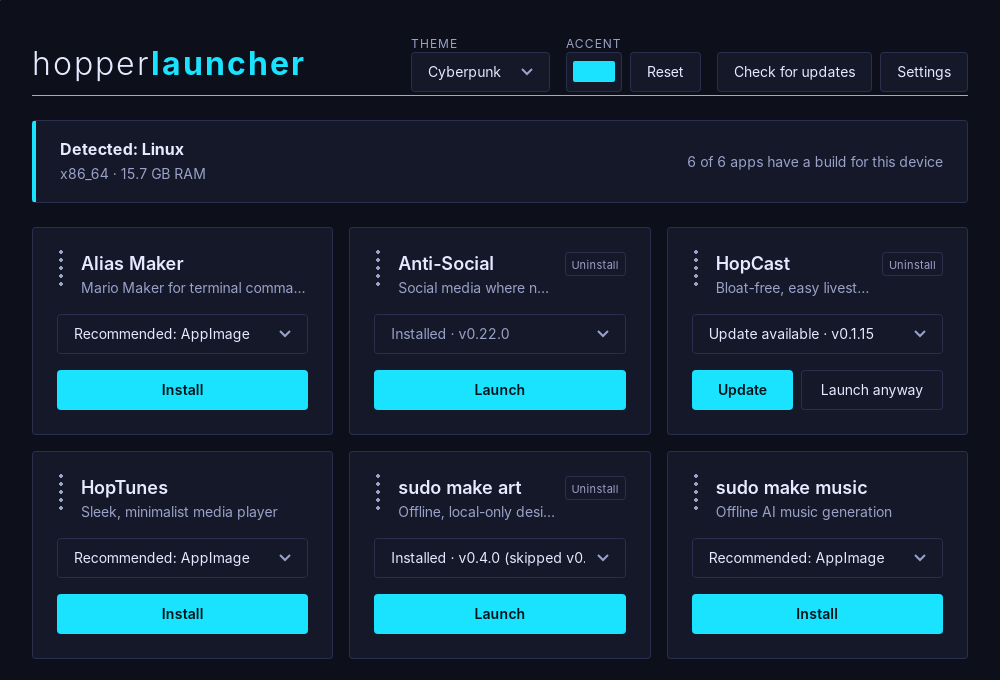
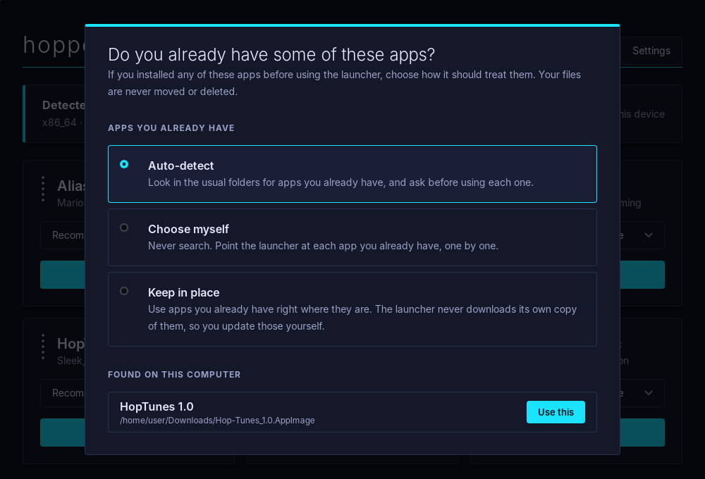
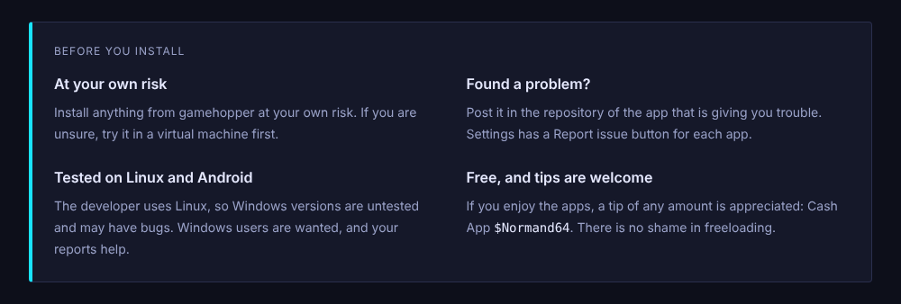
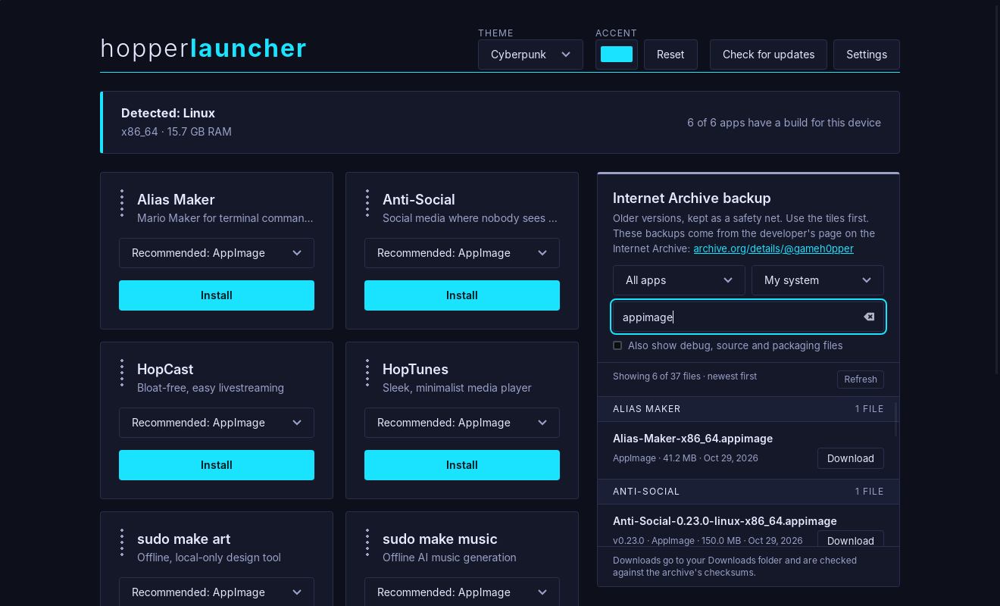
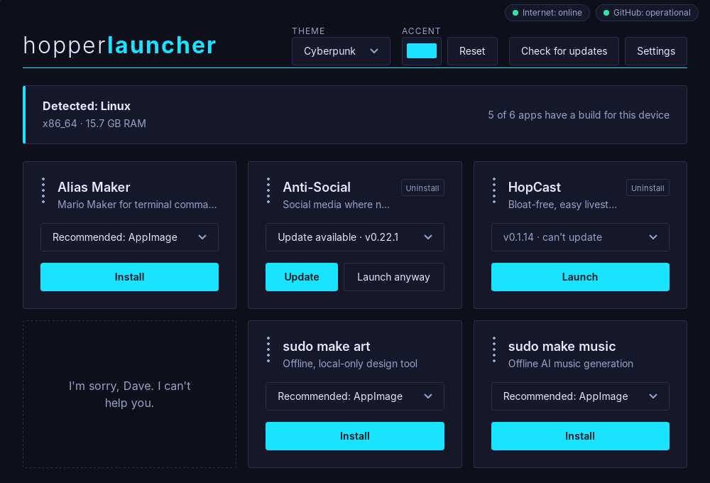
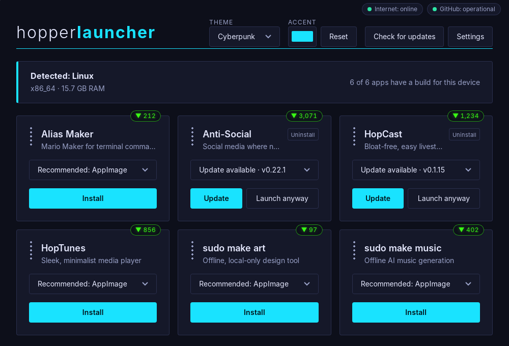
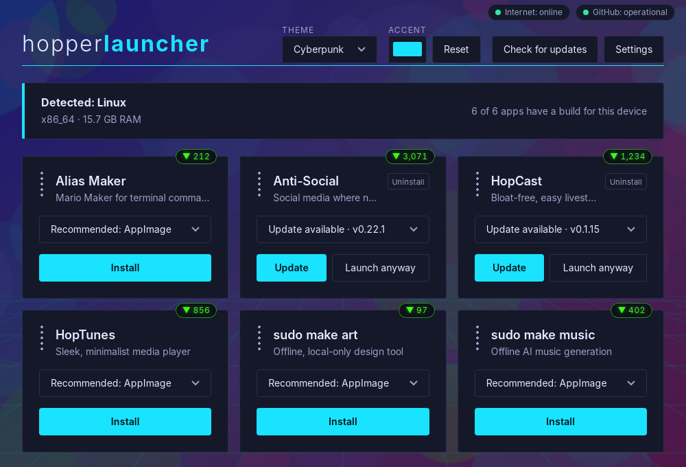
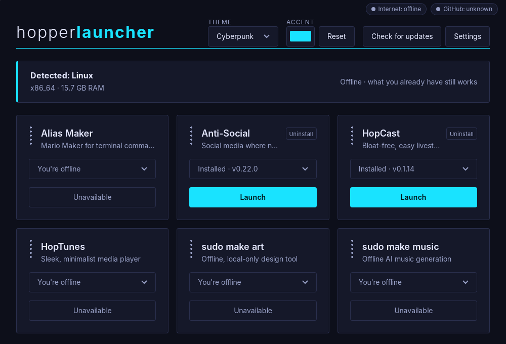
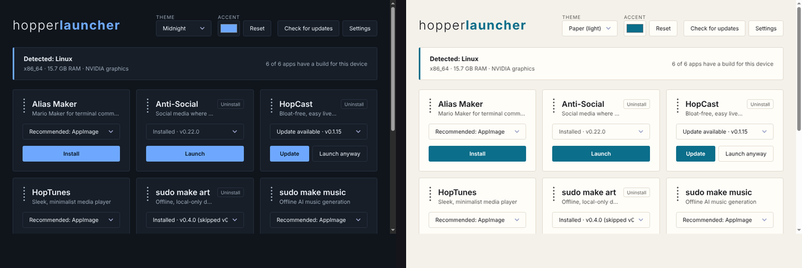

# Hopper Launcher

The GameHopper launchpad: a small, lightweight launcher that gathers the GameHopper apps in
one place. It runs on Linux and Windows, and there is an Android test build. It launches the apps
you have installed, downloads them from their GitHub releases when you don't, and tells you when an
update is available.

> [!WARNING]
> **Tested on Linux only, for now.** The developer has tested these apps on Linux only. On Linux,
> every app launches as it should (earlier launch problems are fixed in version 0.1.2 and later, so use
> the [latest release](../../releases/latest)). The Windows and Android versions exist but have **not** been tested by the
> developer and may have bugs.
>
> **Download at your own risk.** If you are unsure, run it in a virtual machine first.
>
> **Scan before you run.** Check every download with [VirusTotal](https://www.virustotal.com) before
> you open it, and stay safe. Windows may also show a SmartScreen warning, because the installer is
> not signed.

## What it looks like



*The main window. Each app has a tile with a dropdown of the builds that suit your device and one button. Here HopCast has a newer release, so its button reads **Update**, with **Launch anyway** beside it. Anti-Social is up to date, and sudo make art has an update the user chose to skip. Drag the dots on a tile to put the apps in your own order.*



*On first run the launcher asks whether you already have some of the apps. Your own files are never moved or deleted.*



*Below the tiles, a short "Before you install" panel.*



*The Internet Archive backup, which is off by default. When it is switched on in Settings, a list of preserved files appears beside the tiles, with filters and a search box. You pick a file yourself, and it is checked and saved to your Downloads folder.*



*If an app's repository disappears and the app is not installed, its slot shows a short message instead of an install button. An app you have installed always keeps its tile and **Launch** button; it just can't update. The two small indicators in the corner show your internet and GitHub's status.*



*Each tile shows how many times that app has been downloaded in total, across every version and every system, taken from GitHub's own public numbers. (These pictures use sample numbers.)*



*Your own picture as the background (Settings, Background). The tiles stay solid so everything stays readable, and Dim and Blur sliders let you choose how much of the picture shows. (This is a sample picture.)*



*With no internet, nothing you already have stops working. The corner turns grey and the rest says so plainly.*



*Three themes (Cyberpunk is the default, shown above), plus an accent colour picker. Midnight and Paper are shown here.*

These pictures use sample data. The versions and installs shown are made up for the screenshots.

## Download

### [**Download the latest release**](../../releases/latest)

That link always opens the newest release, so it stays current when new versions come out. Older
versions are on the [Releases page](../../releases). On the latest release, scroll to **Assets** and pick
the file for your system:

| System | File | Notes |
|---|---|---|
| Linux (x86_64) | `Hopper-Launcher-<version>-x86_64.AppImage` | Mark it as executable, then run it. If your system has no FUSE, run it with `--appimage-extract-and-run`. |
| Windows (64-bit) | `Hopper-Launcher-Setup-<version>-x64.exe` or `Hopper-Launcher-<version>-windows-x64.zip` | The installer sets it up; the zip is a single program you can run from anywhere. Untested by the developer. |
| Android | none yet | An APK exists only as a test build and has never been run on a phone. It is not released. |

Every release also has checksum files: `SHA256SUMS` for Linux and `SHA256SUMS-windows` for Windows.
To check a download, run `sha256sum -c SHA256SUMS` on Linux, or
`Get-FileHash <file> -Algorithm SHA256` in Windows PowerShell and compare it with the checksum file.
Please also scan the file with [VirusTotal](https://www.virustotal.com) first (see the warning above).

## Apps

| App | What it is |
|---|---|
| Alias Maker | Create your own custom terminal commands, with safety rails |
| Anti-Social | Social media where nobody sees your posts |
| HopCast | Bloat-free, easy livestreaming |
| HopTunes | A sleek, minimalist media player |
| sudo make art | Offline, local-only design tool |
| sudo make music | Offline AI music generation |

All of them are free to use. The launcher itself collects no data and needs no account. Each app's own
page says which systems it supports, and the launcher only shows the builds that suit your device.

## Before you install

- Install anything from gamehopper at your own risk. If you are unsure, try it in a virtual machine first.
- If you have a problem, post it in the repository of the app that is giving you trouble.
- The developer uses Linux and has tested only the Linux versions so far. Windows and Android versions are untested and may have bugs. Windows users are wanted, and your reports help.
- The apps are free. If you enjoy them, a tip of any amount is appreciated (Cash App `$Normand64`), and you can also support the developer's [Locals](https://locals.com/gamehopper). But there is no shame in freeloading.

## How it works

- `apps.json` lists the apps (name, tagline and GitHub repo). It never scans an
  account, so only apps listed there can appear.
- The launcher reads each app's latest GitHub release and shows only the builds
  that suit your device in a dropdown, best one first. Debug builds are ignored.
- Downloads are checked against the release's `SHA256SUMS` file when one is published.
- **Internet Archive backup (off by default).** As a safety net in case a repository, or GitHub itself,
  is ever unavailable, older versions of each app are kept on the developer's Internet Archive page:
  [archive.org/details/@gameh0pper](https://archive.org/details/@gameh0pper). Switch it on in Settings and a
  list appears beside the apps. You choose the file yourself; it is saved to your Downloads folder and
  checked against the archive's checksums (and the developer's `SHA256SUMS` when one is there). The launcher
  only contacts archive.org while this is switched on, and it never switches to it by itself.
- Launched apps run on their own, so closing the launcher never closes them.
- **Your own background.** In Settings, "Choose an image…" lets you use your own PNG, JPEG or WebP picture
  (under 12 MB) behind the apps. A copy is kept inside the launcher, so it keeps working if the original is
  moved or deleted, and nothing is sent anywhere. The tiles stay solid so text stays readable; Dim and Blur
  sliders and a Remove button put you in control. Still pictures only (no animations or SVG). Desktop for now.
- **Download counts.** A small green number on each tile shows how many times that app has been downloaded,
  added up across every version and every system (Linux, Windows and Android all count toward one total). It
  uses GitHub's own public download numbers, so nothing is sent and nobody is identified. Checksum, debug and
  source files are not counted. It is GitHub's figure, so it includes anyone who downloaded by any means, and
  if a release file is ever deleted and re-uploaded its count starts again. The last number is kept for when
  you are offline, and there is a switch in Settings to hide it.
- **Nothing needs the internet to work.** Apps you have installed launch offline, and settings, themes and
  ordering all work. Only installing, updating and browsing the backup need a connection.
- **Status in the corner.** Two small indicators show whether you are online and whether GitHub is working
  (it reads GitHub's own status page, githubstatus.com). On by default; there is a switch in Settings.
- **If an app can no longer be delivered** (its repository is pulled, or GitHub is gone), an app you have
  installed keeps its tile and **Launch** button and simply can't update. An app you have *not* installed is
  replaced by a short message, "I'm sorry, Dave. I can't help you." The launcher is patient about this: a
  repository must be reported missing twice, at least a day apart, or GitHub must be unreachable for a full
  week while your internet works. Being offline, a short outage or a rate limit never removes anything, and
  it all comes back by itself when the source does.
- It only talks to the internet while it is open: GitHub (to read releases), githubstatus.com (for the corner
  status; can be switched off), archive.org (only if you switch the backup on) and, only when GitHub does not
  answer, a bare connection to a public DNS server (nothing is sent) to tell "you are offline" from "GitHub is down".
- How apps are installed: on Linux an AppImage is saved and made runnable; on Windows a zip is unpacked
  and an installer is handed to Windows; on Android the APK is handed to Android's own installer.
- Apps it installs live in `~/.local/share/hopper-launcher/` on Linux and `%APPDATA%\hopper-launcher\`
  on Windows. Updating or uninstalling never touches an app's own settings or data.
- Apps it starts get your system's own settings, not the launcher's. (Earlier versions passed the
  launcher's AppImage settings on, which stopped sudo make music, Alias Maker and HopCast from starting.
  That is fixed in 0.1.2.)
- Already have some of the apps? Settings, "Apps you already have", lets you
  choose: auto-detect, choose myself, or keep in place. Your own files are never
  moved or deleted.
- It checks GitHub for new releases when it opens and every 3 hours while open. When one
  appears, the button becomes Update, with Launch anyway beside it and a choice to skip that version.
- Drag the handle on a tile (or use the arrow keys) to put the apps in your own order.
- Themes: Cyberpunk, Midnight and Paper, plus an accent colour picker.
- Each app has a **Report issue** button in Settings that opens that app's own issues page.
- To use your own list, place an `apps.json` in `~/.config/hopper-launcher/` (Linux) or
  `%APPDATA%\hopper-launcher\` (Windows).

## Building

Requires Rust and the Tauri 2 system dependencies (WebKitGTK 4.1, GTK 3).

```sh
cd src-tauri
cargo test            # run the tests
cargo build --release
```

**Status**
- **Linux:** working, and tested by the developer.
- **Windows:** the installer and zip are built automatically on GitHub and compile cleanly, but have not
  been run or tested by the developer.
- **Android:** a debug APK can be built with the manual "Android test build" workflow. It builds and
  contains the install and launch plugin, but it has never been run on a phone and is not released.

**Releases.** Pushing a version tag such as `v0.1.3` runs the Release workflow. It runs the tests, builds
the Linux AppImage and the Windows installer and zip, writes the checksum files, and attaches everything
to the release. See `ROADMAP.md` and `DESIGN.md` for the plans and the reasoning behind the design.

## Disclaimer

This project is independent and is not affiliated with, endorsed by, or
sponsored by any other company or product. All product names, logos and
trademarks mentioned anywhere are the property of their respective owners.
The software is provided "as is", without warranty of any kind.

## License

No license has been chosen yet. Until one is added, all rights are reserved by
the author.
